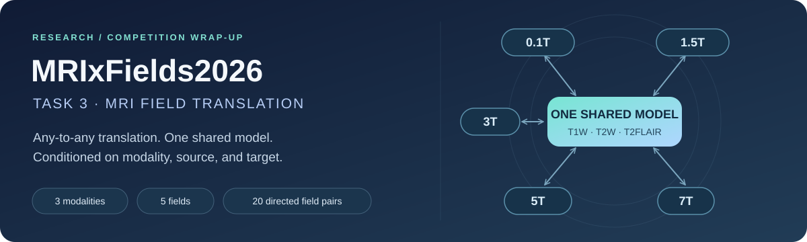

# MRIxFields2026 · Task 3

**One model. Three modalities. Twenty translation directions.**

A post-competition record of controllable, any-to-any MRI field translation:
the official StarGAN v2 baseline, a conditional FPS-Former adaptation, and the
tools used to audit, run, and validate predictions.

[Results](#results) · [What we built](#what-we-built) ·
[Reproduce the baseline](#reproduce-the-baseline) ·
[Notebooks](#notebooks-and-guides) · [Evidence notes](docs/results.md)

## At a glance

| Scope | Coverage |
| --- | --- |
| Competition task | Task 3 — controllable any-to-any, multimodal field translation |
| MRI modalities | T1W · T2W · T2FLAIR |
| Magnetic fields | 0.1T · 1.5T · 3T · 5T · 7T |
| Model contract | One shared conditional model per experiment; modality, source field, and target field conditioning |
| Validation sweep | 45 input scans → 180 predictions across 60 modality/pair groups |

All 20 directed non-identity field pairs are covered, including translations
to lower fields. This repository does not address the other competition tasks.
See the organizers' [Task 3 rules](https://mrixfields.chihucloud.com/2026/tasks.html).

Competition participation has concluded. The notebooks remain available for
reproduction and study; their presence does not imply submissions are still open.

## Results

Three FPS-Former validation submissions are recorded in the project experiment
log. **Target 200 was the best of these three on all overall metrics.**

| FPS-Former run | Submission ID | nRMSE ↓ | SSIM ↑ | LPIPS ↓ |
| --- | --- | ---: | ---: | ---: |
| Initial · 30 epochs | `9778284` | 0.283937 | 0.864881 | 0.156116 |
| Target 150 | `9778735` | 0.248285 | 0.878918 | 0.149620 |
| **Target 200** | **`9779018`** | **0.247053** | **0.879531** | **0.149198** |

Overall nRMSE fell **13.0%** from the first to the best recorded submission.
Most of that gain came by target 150 (12.6%); the final target extension added
only another 0.5% improvement. These are successive experiments, not a
controlled epoch-only ablation: patch size and batch size also changed.

<details>
<summary>Best recorded submission — breakdown by modality</summary>

| Modality | nRMSE ↓ | SSIM ↑ | LPIPS ↓ |
| --- | ---: | ---: | ---: |
| T1W | 0.256103 | 0.882085 | 0.159128 |
| T2W | 0.278586 | 0.878456 | 0.147530 |
| T2FLAIR | 0.206470 | 0.878053 | 0.140936 |

</details>

These are recorded **public-validation leaderboard scores**, not local
holdout scores or an independently verified final test ranking. “Target 150”
and “target 200” describe configured training targets, not necessarily the
selected checkpoint epoch. Submission dates, source hashes, checkpoint
selection caveats, and historical archive checks are in the
[results and evidence notes](docs/results.md).

### What we learned

Longer training lowered L1 loss, but local holdout nRMSE worsened during the
target-200 continuation, particularly for T2FLAIR. Public-validation scores
still improved slightly overall. The takeaway: lower training loss is not
proof of better translation, and local slice-level diagnostics must stay
separate from organizer-evaluated validation results.

## What we built

| Component | Purpose | Recorded status |
| --- | --- | --- |
| Official shared StarGAN v2 baseline | Establish the full inference and submission pipeline | Completion documented in the project wrap-up; artifacts retained privately |
| Conditional FPS-Former | Adapt frequency, spatial, and multi-scale modeling to field translation | Three recorded validation submissions; results above |
| Conditional 3D U-Net | Prepare a controlled volumetric follow-up | Implemented and tested; no measured result for this implementation in the wrap-up |
| Audit and submission tools | Validate domains, files, spatial metadata, numerical values, and archives | Shared by the reproducible workflows |

FPS-Former is a **Task 3 adaptation**, not an exact reproduction of the original
MRI reconstruction method. The [package guide](task3_fpsformer/README.md)
explains the architectural differences and links the reference paper.

## Reproduce the baseline

The pretrained workflow is the easiest starting point. You need access to the
released validation data, a GPU runtime, and the official shared checkpoint;
medical images and model weights are not bundled with this repository.

1. Open the [pretrained Colab notebook](notebooks/task3_pretrained_baseline_colab.ipynb)
   in Google Colab and select a GPU runtime.
2. Put `task3_pipeline.py`, `task3_build_submission.py`, and
   `requirements-colab.txt` in your private Drive source folder. Configure the
   notebook's code, validation-data, checkpoint, and export paths.
3. Run staging and audits, then enable one smoke translation. Continue to the
   full 180-prediction sweep only after the smoke checks pass.
4. For archive reproduction, review the official format, enable packaging,
   and export the checked `task3.zip` and provenance reports.

Inputs are copied to runtime storage and Drive is unmounted before processing.
Runtime files disappear when the session resets, so export before leaving.
The notebook never uploads an archive or starts training automatically.

Prefer Kaggle? Use the [dual-T4 notebook](notebooks/task3_pretrained_baseline_kaggle.ipynb).
For terminal commands, revision pins, storage requirements, and the submission
tree, see the [baseline guide](docs/baseline.md).

## Notebooks and guides

| Workflow | Notebook | Documentation |
| --- | --- | --- |
| Official pretrained baseline | [Colab](notebooks/task3_pretrained_baseline_colab.ipynb) · [Kaggle](notebooks/task3_pretrained_baseline_kaggle.ipynb) | [Baseline guide](docs/baseline.md) |
| Conditional FPS-Former | [Colab](task3_fpsformer/task3_fpsformer_colab.ipynb) | [Model and experiment guide](task3_fpsformer/README.md) |
| StarGAN v2 training | [Colab](notebooks/task3_stargan_v2_colab.ipynb) | [Training guide](docs/training.md) |
| Conditional 3D U-Net | [Colab](notebooks/task3_3d_unet_colab.ipynb) | [Model and ablation guide](task3_3d_unet/README.md) |

Training is opt-in. Review run switches, baseline prerequisites, and compute
costs before enabling an experimental workflow. The StarGAN training notebook
is separate from validation inference and archive packaging.

## Repository map

```text
notebooks/                 Colab and Kaggle workflows
docs/                      Results, evidence notes, and practical guides
tests/                     Pipeline and notebook regression checks
tools/                     Prediction review, metric plots, and VRAM probe
task3_fpsformer/            Conditional FPS-Former, notebook, and tests
task3_3d_unet/              Conditional 3D U-Net and tests
task3_pipeline.py          Audit, plan, infer, and validate full volumes
task3_build_submission.py  Official builder wrapper and archive validation
task3_colab_train.py       StarGAN training helper
```

Data, credentials, checkpoints, predictions, archives, raw experiment logs,
generated reports, and saved notebook copies stay out of Git. Only the curated
results summary and documentation artwork are included. Organizer code is
fetched separately into `official/MRIxFields2026/`.

## Check the code

Lightweight tests need Python 3.10+ and no GPU:

```bash
python3 -m unittest -v tests.test_task3_pipeline tests.test_task3_colab_train
```

For the full suite, use an environment with the packages' PyTorch/NIfTI
dependencies installed. The existing local environment can run it with:

```bash
.venv-fpsformer/bin/python -m unittest discover -v
```

Environment setup is covered in the [FPS-Former guide](task3_fpsformer/README.md)
and [baseline guide](docs/baseline.md). Unit tests check implementation and
workflow behavior; they do not reproduce GPU training or leaderboard scores.

## References

[Competition](https://mrixfields.chihucloud.com/2026/) ·
[Data access](https://mrixfields.chihucloud.com/2026/data.html) ·
[Task rules](https://mrixfields.chihucloud.com/2026/tasks.html) ·
[Organizer code](https://github.com/MRIxFields/MRIxFields2026) ·
[Shared Task 3 weights](https://huggingface.co/mrixfields/MRIxFields2026-Baseline/tree/main/task3_any_to_any_multimodal) ·
[Submission format](https://github.com/MRIxFields/MRIxFields2026/blob/main/Submission/README.md)

Research code for the competition workflow; not a clinical diagnostic tool.
